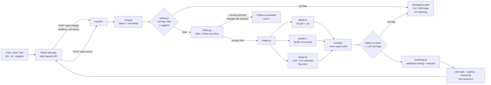

# CareCompass

**AI care routing for home healthcare in India.** Built at the HackIIITD grand finale (CAI, IIIT-Delhi), track *AI for Healthcare Access*, by team **OCTUPUS** (KIET Group of Institutions).

A user, often elderly or with low literacy, types or speaks a request in **English, Hindi or Hinglish** ("Papa ko do din se bukhar hai aur khansi bhi"). CareCompass decides:

1. **What care** fits: paramedic home visit, nurse home visit, GP teleconsult, specialist referral, or emergency referral
2. **How urgent** it is: routine, same-day, or immediate
3. **Who should go**: the best available caregiver, ranked by skill, distance, availability, language and rating, with a reason for each

**Any red flag skips matching** and shows an emergency screen with one-tap 112 / 108 calls and call-for-help steps.

> ⚠️ CareCompass supports **routing only**. It does not diagnose or prescribe, and it never shows disease or medicine names.

---

## Architecture



| Module | File | What it does |
|---|---|---|
| Language | `backend/app/lang.py` | Script and token-based detection of en / hi / hinglish; maps Hindi and Hinglish symptom words (bukhar, khansi, saans phoolna, चक्कर…) to canonical English |
| Safety | `backend/app/safety.py` | Deterministic red-flag engine in three languages with clause-scoped negation ("saans ki dikkat **nahi** hai"). Runs on raw input, normalised input and every user turn |
| Intake | `backend/app/intake.py` | Extracts symptoms, duration, severity, age group, breathing status, mobility. Asks a follow-up only when the decision is uncertain or a high-risk screen applies (safety questions first, at most 4) |
| Triage | `backend/app/triage.py`, `textclf.py`, `llm_triage.py` | Local model (A or C, or their ensemble) plus an optional LLM. On disagreement the more urgent level wins, and safety rules always override |
| Matching | `backend/app/matching.py` | Hard filters on role, specialty, distance and same-day slots, then a weighted score (config). Reasons are built from the actual score components |
| Pipeline | `backend/app/pipeline.py` | Orchestration, per-stage latency logs. On an internal error it returns a safe response, or the emergency path if there is any red-flag doubt |

## Quick start

### Local (Windows PowerShell / bash)
```bash
python -m venv .venv
.venv/Scripts/activate            # Linux/macOS: source .venv/bin/activate
pip install -r requirements.txt

python scripts/make_dev_data.py         # synthetic dev data (already committed)
python scripts/prepare_public_data.py   # optional: needs data/public/* (see below)
python scripts/train.py                 # Model A -> models/model_a.joblib (~10 s)
uvicorn app.main:app --app-dir backend --port 8000
```
Frontend:
```bash
cd frontend
cp .env.example .env     # VITE_API_URL=http://localhost:8000
npm install
npm run dev              # http://localhost:5173
```
API docs: http://localhost:8000/docs

### Docker
```bash
cp .env.example .env     # optional: LLM settings
docker compose up --build
```
Backend on `:8000`, frontend on `:5173`. `data/` and `models/` are mounted as volumes, not baked into images. On first start the backend prepares the public data (if present) and trains Model A automatically. The Docker image is CPU-only and uses Model A plus the optional hosted LLM.

### Optional: GPU (Model C)
```bash
pip install torch --index-url https://download.pytorch.org/whl/cu126   # match your driver (nvidia-smi)
pip install -r requirements-gpu.txt
python scripts/train_transformer.py          # holdout run: compares A vs C vs ensemble, picks production model
python scripts/train_transformer.py --full   # retrain on all data with the same settings
```
If torch or the weights are missing, inference falls back to Model A automatically.

## Data
Nothing in `data/` is committed. See [data/README.md](data/README.md).

| Path | Source |
|---|---|
| `dev_data/` (committed) | **Synthetic, self-generated** by `scripts/make_dev_data.py`: 400 vignettes, 60 caregivers, taxonomy |
| `data/public/ktas/data.csv` | [KTAS triage (Kaggle)](https://www.kaggle.com/datasets/ilkeryildiz/emergency-service-triage-application) |
| `data/public/symptom_severity/` | [Disease Symptom Description (Kaggle)](https://www.kaggle.com/datasets/itachi9604/disease-symptom-description-dataset) |
| `data/public/symptoms_to_diseases/` | [Symptoms to Diseases (Kaggle)](https://www.kaggle.com/datasets/abhishekgodara/symptoms-to-diseases) |
| `data/official/` | Organiser dataset. When present, it is picked up automatically by `backend/app/data_adapter.py` (column and label names mapped via `config/label_map.json`) |

Structure notes: [docs/DATA_NOTES.md](docs/DATA_NOTES.md).

## Environment variables
| Var | Default | Meaning |
|---|---|---|
| `LLM_PROVIDER` | `none` | `openai`, `groq`, `openrouter`, `together`, `gemini`, `anthropic` or `none` |
| `LLM_MODEL` | | Model id for the provider |
| `LLM_API_KEY` | | Never logged |
| `LLM_BASE_URL` | | Optional override for OpenAI-compatible endpoints |
| `LLM_TIMEOUT_S` | `6` | Hard timeout. On timeout or error the system falls back to the local model |
| `DATA_DIR`, `OFFICIAL_DIR`, `PUBLIC_DIR`, `PROCESSED_DIR`, `DEV_DATA_DIR`, `MODELS_DIR`, `CONFIG_DIR` | see `.env.example` | Paths |
| `USE_TRANSFORMER` | `auto` | `false` forces Model A |
| `MAX_FOLLOWUPS` | `4` | Follow-up cap |
| `CORS_ORIGINS` | `*` | Comma-separated |
| `VITE_API_URL` | `http://localhost:8000` | Frontend → backend URL |

## API
| Method | Path | |
|---|---|---|
| `POST` | `/api/v1/triage` | Main endpoint (stateless; send the full `conversation_history` every turn) |
| `GET` | `/api/v1/caregivers/{id}` | Caregiver profile |
| `POST` | `/api/v1/book` | Mock booking. Emergencies are rejected and the response says to call 112 / 108 |
| `GET` | `/api/v1/questions` | Follow-up question bank with quick-reply options (for one-tap chips) |
| `GET` | `/health` | Health check |

```bash
curl -s -X POST http://localhost:8000/api/v1/triage -H "Content-Type: application/json" -d '{
  "user_input": "papa ko do din se bukhar hai aur khansi bhi",
  "language": "auto",
  "location": {"lat": 28.54, "lng": 77.27},
  "conversation_history": []
}'
```
```json
{
  "follow_up_question": null,
  "care_type": "paramedic_home_visit",
  "urgency": "same_day",
  "red_flags": [],
  "reasoning": "Do din se bukhar aur khansi. Sujhav: Paramedic ka ghar aana, aaj hi, taaki ghar par hi jaanch ho sake.",
  "matched_caregivers": [
    {"caregiver_id": "CG_011", "score": 0.76, "reason": "5 km door, aaj 3 pm free, bukhar ki jaanch mein experience, rating 3.9"}
  ]
}
```
When more information is needed, `follow_up_question` is set and the decision fields are `null`. The client appends `{"role":"assistant","content":<question>}` and the user's answer to `conversation_history` and calls again. Questions, reasoning and reasons come back in the user's language.

## Train, evaluate, predict
```bash
python scripts/train.py                      # Model A (serving: all labelled data)
python scripts/evaluate.py [--sweep]         # held-out metrics -> docs/EVAL.md
python scripts/predict.py <test_file> [--use-llm] [--columns id,care_type,urgency]   # -> outputs/predictions.csv
pytest -q                                    # 130+ tests, including safety
```
Latest metrics: [docs/EVAL.md](docs/EVAL.md).

## Safety design
- **Rules first and last.** The red-flag engine runs before any model and again after the model and LLM have decided. The LLM's red flags are unioned in. Any flag means `emergency_referral` + `immediate`, no follow-ups and no caregiver matching.
- **Coverage.** Chest pain or pressure, severe breathing difficulty, blue lips, unconsciousness, seizure, stroke signs (face droop, slurred speech, one-sided weakness), heavy bleeding, face or throat swelling, suicidal intent or self-harm, poisoning or overdose, severe burns, major trauma, sudden confusion, high fever with stiff neck, infant danger signs, pregnancy bleeding or pain, and serious head injury. Each is covered in English, Devanagari and Hinglish spellings.
- **Negation-aware.** Negation is clause-scoped: English pre-negation ("no chest pain") and Hindi post-negation ("seene mein dard nahi hai"). Patterns that contain a negation themselves ("saans nahi aa rahi", "jawab nahi de rahe") still fire.
- **Asymmetric decisions.** If the local model and the LLM disagree on urgency, the more urgent one wins. The model's emergency threshold is set low (0.35).
- **Safety screening.** A "yes" to a screening question (breathing, chest pain, stiff neck) becomes a red flag.
- **Fail safe.** On any internal error the pipeline returns a conservative same-day consult, or the emergency path if the rules see any risk.
- **Tests.** `tests/test_safety.py` has 66 positive and 25 negated or benign cases written by the team. They must pass before any commit that touches `safety.py`.

## Docs
- [docs/WRITEUP.md](docs/WRITEUP.md): 2-page write-up
- [docs/DECLARATIONS.md](docs/DECLARATIONS.md): every model, API, library and dataset used
- [docs/EVAL.md](docs/EVAL.md): evaluation
- [docs/DEMO_SCRIPT.md](docs/DEMO_SCRIPT.md): demo video plan
- [docs/DATA_NOTES.md](docs/DATA_NOTES.md): data structure
